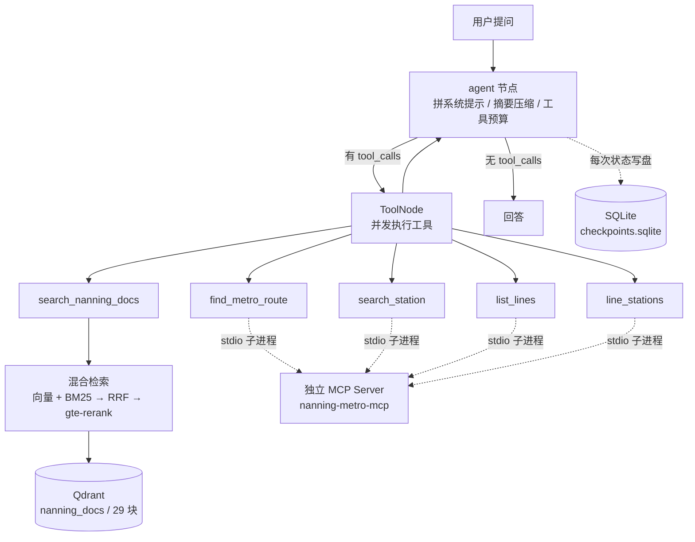

# 南宁出行助手（nanning-travel-agent）

基于 LangGraph 的南宁地铁出行问答 Agent。把两类完全不同的问题接到一起：

- **政策类**（票价、优惠、运营时间、计次票）→ 本地文档 RAG
- **换乘类**（两站之间怎么走、几站、多久）→ 自研 MCP 地铁服务
- **混合类**（"从金湖广场到南宁剧场怎么走？周五晚上最晚几点还能坐？"）→ 两个工具串联

模型自己决定调哪个工具、调几次，会话落盘到 SQLite，长对话自动压缩成摘要。

| 指标 | 结果 |
|---|---|
| 18 条四类评测 | **18/18 通过**（本轮；e1 错站名题对模型行为敏感，上一轮 17/18） |
| 平均单题耗时 | **6.9s**（`deepseek-flash`，含工具往返） |
| 检索命中（5 条政策 query，hit@1） | **5/5**，hybrid+rerank 后首位相关性 0.467–0.953 |
| RAGAS（17 条有上下文的题） | faithfulness **0.777** / answer_relevancy **0.904** |

## 能回答什么

| 问题 | 走的路径 |
|---|---|
| 南宁地铁起步价是多少，这个价格能坐多远？ | RAG（票价计价规则） |
| 从朝阳广场到火车东站怎么走？ | MCP `find_metro_route`，1 号线 13 站 24.43 分钟 |
| 从新民路到南宁剧场怎么走？用市民卡要多少钱？ | 先换乘查询，再查优惠政策 |
| 3 号线经过哪些站？ | MCP `line_stations` |
| 南宁东站是哪条线的？ | MCP `search_station`（高铁站名 → 提示正确站名是「火车东站」） |
| 从朝阳广场到北京西站怎么走？ | 明确回答"查不到"，不编 |

## 架构



### 五个工具

| 工具 | 来源 | 作用 |
|---|---|---|
| `search_nanning_docs` | 本仓库 `rag/tools.py` | 政策文档检索，返回带标题路径的片段；无相关结果返回 `NO_RELEVANT_DOCS` |
| `find_metro_route` | MCP | 两站最快路径、站数、耗时（含换乘） |
| `search_station` | MCP | 站名模糊搜索、纠正错别字、提示换乘站 |
| `list_lines` | MCP | 线路清单：起终点、站数、换乘站 |
| `line_stations` | MCP | 某条线的完整站序 |

MCP 服务是**独立进程 + 独立仓库**（[nanning-metro-mcp](https://github.com/well-root/nanning-metro-mcp)），通过 stdio 接入，换 agent 框架不用动它。

### 检索管线

```
query
 ├─ 向量检索：text-embedding-v4（1024 维）→ Qdrant 余弦，取 8 条，阈值 0.60
 ├─ 稀疏检索：BM25Okapi + 中文 2-gram 分词，取 8 条
 ├─ RRF 融合：score = Σ 1/(60 + rank)，取前 12 条候选
 └─ 重排：阿里云 gte-rerank-v2 → 取前 4 条
```

- 切块：按 Markdown 标题层级切（`CHUNK_MAX=600`、`CHUNK_OVERLAP=80`，最长再二次切分），每块保留标题栈作为 metadata
- 重排失败自动退回 RRF 顺序（`retrieval.py` 里 try/except），不打断问答
- 开关：`RETRIEVAL_MODE=vector|hybrid`、`RERANK=0|1`

### 记忆与预算

| 机制 | 实现 |
|---|---|
| 会话持久化 | `AsyncSqliteSaver` → `data/memory/checkpoints.sqlite`，`thread_id` 切换会话 |
| 滚动摘要 | 消息数 > `SUMMARY_THRESHOLD=10` 时，把最近 4 轮之前的内容压成一条 SystemMessage，并用 `RemoveMessage` 删原消息 |
| 工具预算 | `MAX_TOOL_ROUNDS=6`，到上限改用不带工具的模型调用，强制收口 |
| 长期记忆（跨会话偏好） | **未实现**，目前只有会话内摘要 |

## 关键取舍

1. **换乘查询不做 RAG。** 站名/站数/耗时是结构化计算，塞进向量库只会召回到"看起来像"的线路文档，答案容易错。所以另写 MCP 服务，用真实线路数据算。
2. **政策类必须混合检索。** 语料里全是「宁仔计次票」「一码通城」这类专有名词，纯向量对长专名召回不稳定，BM25 + RRF 兜底，再用 rerank 精排。
3. **不用 `AgentExecutor`。** 需要自己控制三件事：工具调用预算、摘要压缩时机、站名错误后的重试策略，LangGraph 的图结构比黑盒 agent 好插手。
4. **判分以规则为主、RAGAS 为辅。** 规则判分（工具子集 + 关键词包含/排除 + 全半角归一）零成本、可复现，适合每次改动挡住回归；RAGAS 补语义指标，但只覆盖有文档上下文的题。

## 数据与来源

| 项 | 内容 |
|---|---|
| 语料 | `data/docs/` 10 篇：票价计价、票种优惠、计次票、车票使用、运营时间、1–5 号线站序 |
| 切块 | 29 块（集合 `nanning_docs`，1024 维，Cosine） |
| 地铁数据 | 独立仓库的 `data/nanning_metro.json`（高德静态线路数据），`scripts/build_line_docs.py` 生成线路文档，可复现 |
| 来源与局限 | 全部登记在 [`data/SOURCES.md`](data/SOURCES.md)：维基为二手来源、官网公告是图片（OCR 尝试失败已记录）、无逐站首末班车时刻 |

票价政策文本制定于 2016 年，运营时间通告有效期至 2025 年底。涉及具体金额和时间的回答，正式使用前需对照官网当前公告——这一条写在 `SOURCES.md` 里，也写在回答里。

## 评测

### 1. 规则判分：18 条四类题库

`eval/queries.jsonl`，每条含期望工具、必含关键词、禁止词。判分逻辑在 `eval/judge.py`。

| 类别 | 条数 | 通过 | 内容 |
|---|---|---|---|
| policy | 5 | 5 | 起步价、市民卡折扣、计次票、运营时间、公交地铁换乘优惠 |
| route | 6 | 6 | 4 条换乘 + 线路清单 + 某线站序 |
| mixed | 3 | 3 | 换乘 + 票价 / 换乘 + 运营时间 |
| edge | 4 | 4 | 跨城站名、高铁站名、意图外、站名归属 |
| **合计** | **18** | **18（本轮）** | 平均 6.9s |

**关于稳定性**：这 18 条不是每次满分。e1（`从朝阳广场到北京西站怎么走？`）对提示词和模型行为敏感——本轮它连搜 4 次站名才去调 `find_metro_route`（10 条消息、7.9s），最终通过；另一轮只搜站名、没去算路线，于是工具判定失败。多次运行的结果分布在 17/18 ~ 18/18 之间，e1 是唯一的波动源。

### 2. 检索消融：5 条政策 query × 3 种配置

`uv run python scripts/test_retrieval.py`

| 配置 | hit@1 | 各条首位分数 |
|---|---|---|
| vector（纯向量） | 5/5 | 0.880 / 0.873 / 0.763 / 0.904 / 0.684 |
| hybrid（向量+BM25 RRF） | 5/5 | 0.033 × 5（RRF 倒数分，非相关性） |
| hybrid + rerank | 5/5 | 0.936 / 0.918 / 0.738 / 0.953 / 0.467 |

**怎么读这张表**：三种配置的 hit@1 都是 5/5，说明在 29 块的语料规模下，检索**召回**不是瓶颈；差异体现在排序置信度和答案质量上。三列分数来自三套不同的打分函数（余弦相似度 / RRF 倒数 / 重排相关性），**不能横向比较**。最后一题（公交地铁 90 分钟换乘优惠）重排分数 0.467 明显偏低，它涉及两篇文档的内容，是当前语料覆盖的弱点。

### 3. RAGAS：faithfulness / answer_relevancy

`uv run python eval/ragas_eval.py`，读最新一次 `eval/results/*_dual.jsonl`。判分用的上下文是**文档片段 + 工具原始输出**的并集：`judge.py` 在跑题时同时记录 `rag_contexts`（`search_nanning_docs` 的召回块）和 `tool_contexts`（换乘/站名/线路工具的返回），RAGAS 取两者合并后再评。judge 模型 `deepseek-flash`、`temperature=0`。

| 类别 | 条数 | faithfulness | answer_relevancy |
|---|---|---|---|
| policy | 5 | 0.859 | 0.878 |
| route | 6 | 0.760 | 0.914 |
| mixed | 3 | 0.835 | 0.923 |
| edge | 3 | 0.619 | 0.911 |
| **合计** | **17** | **0.777** | **0.904** |

**口径修正前后**：最初只把 `rag_contexts` 交给 RAGAS，8 条题的 faithfulness 是 0.688，其中混合题 m2/m3 只有 0.304/0.324——不是回答错了，而是路线事实来自 MCP 工具、不在文档上下文里，被判成"不忠实"。合并 `tool_contexts` 后覆盖 17 条，m2/m3 升到 0.762/0.914，均值 0.777。

**剩下的低分怎么解释**：

- `edge` 的 0.619 最低。e1（0.600）答案里给出了"朝阳广场 → 火车站，1 号线 1 站约 2 分钟"的替代路线，这是模型把"北京西站"猜成"火车站"后的推断，工具里并没有这条对应关系；t3（0.556）站名归属题补充了换乘与线路延伸的说明，部分内容超出工具输出。
- `route` 的 0.760：长站序回答常补"不用换乘""约 X 分钟"这类归纳，工具只给站列表和总时长，逐条事实判分偏严。
- 17 条没有低于 0.55 的，不存在整段编造。

## 快速开始

前置：Python 3.12、[uv](https://docs.astral.sh/uv/)、Docker、两个仓库都 clone 到本地。

```powershell
git clone https://github.com/well-root/nanning-travel-agent.git
git clone https://github.com/well-root/nanning-metro-mcp.git    # 建议放同级目录
cd nanning-travel-agent
uv sync
```

`.env`（不提交，模板见下表）：

```
DEEPSEEK_API_KEY=sk-xxx        # deepseek-flash / deepseek-chat
DASHSCOPE_API_KEY=sk-xxx       # text-embedding-v4 与 gte-rerank-v2
```

| 步骤 | 命令 |
|---|---|
| 启动向量库 | `docker start qdrant`，健康检查 `curl.exe -s http://localhost:6333/readyz` |
| 建索引（首次/改语料后） | `uv run python -m nanning_travel_agent.rag.ingest` |
| 验收 MCP 连通 | `uv run python scripts/test_mcp_direct.py` |
| 验收检索 | `uv run python scripts/test_retrieval.py` |
| 命令行问答 | `uv run python -m nanning_travel_agent.app` |
| 网页界面 | `uv run streamlit run src/nanning_travel_agent/ui.py` |
| 18 条评测 | `uv run python eval/judge.py`（`--ids m1,m2,m3` 只跑指定题） |
| RAGAS | `uv run python eval/ragas_eval.py`（先跑 judge） |
| 并行取数子图冒烟 | `uv run python scripts/test_gather.py` |

Qdrant 首次创建（容器还没有时）：

```powershell
docker run -d --name qdrant -p 6333:6333 -v ${PWD}/qdrant_storage:/qdrant/storage qdrant/qdrant
```

MCP 服务路径默认写在 `metro_mcp/metro_client.py` 里，可用环境变量覆盖：

| 变量 | 默认值 | 说明 |
|---|---|---|
| `NANNING_METRO_PYTHON` | `D:\agent\nanning-metro-mcp\.venv\Scripts\python.exe` | MCP 服务的解释器 |
| `NANNING_METRO_SERVER` | `D:\agent\nanning-metro-mcp\src\nanning_metro_mcp\server.py` | 服务入口 |
| `RETRIEVAL_MODE` | `hybrid` | `vector` 退回纯向量 |
| `RERANK` | `1` | `0` 关闭重排 |
| `MAX_TOOL_ROUNDS` | `6` | 单轮工具调用上限 |
| `SUMMARY_THRESHOLD` | `10` | 触发摘要的消息条数 |

## 项目结构

```
nanning-travel-agent/
├── src/nanning_travel_agent/
│   ├── app.py                # CLI 入口：SqliteSaver + 多轮会话
│   ├── ui.py                 # Streamlit 界面，侧栏可切 thread_id / 模型 / 温度
│   ├── agent/
│   │   ├── graph.py          # 建图：agent ↔ ToolNode，摘要压缩与工具预算
│   │   └── gather.py         # 并行取数子图（Send 扇出），已实现、默认不接入
│   ├── rag/
│   │   ├── ingest.py         # Markdown 结构化切块 → 阿里云 embedding → Qdrant
│   │   ├── retrieval.py      # 向量 + BM25 + RRF + rerank
│   │   ├── tools.py          # search_nanning_docs 工具封装
│   │   ├── embedding.py      # text-embedding-v4，批 10
│   │   └── config.py         # 切块/检索/collection 参数
│   └── metro_mcp/
│       └── metro_client.py   # 通过 stdio 加载 4 个 MCP 工具
├── data/
│   ├── docs/                 # 10 篇语料（带 frontmatter）
│   ├── SOURCES.md            # 来源与局限登记
│   ├── raw/                  # 原始存档，不入索引、不提交
│   └── memory/               # checkpoints.sqlite，不提交
├── scripts/                  # 一次性脚本：建线路文档、连通性、检索验收、子图冒烟
├── eval/                     # queries.jsonl / judge.py / ragas_eval.py / results/
```

## 已知局限

1. **语料规模小**：10 篇、29 块。覆盖的是票价、优惠、运营时间和 5 条线路站序，**没有逐站首末班时刻**，也没有换乘步行耗时明细。
2. **官网公告抓不到正文**：`nngdjt.com` 票务文章正文是图片，DeepSeek-OCR 试过 4 次，章节标题可读但小字部分出现幻觉复读，未入语料。详见 `data/SOURCES.md`。
3. **错站名会给替代路线**：e1 问"到北京西站怎么走"，回答里仍给出"朝阳广场 → 火车站，1 号线 1 站约 2 分钟"（模型把"北京西站"猜成了"火车站"）。规则判分只校验"是否明确说了查不到"，拦不住这类语义投机；RAGAS 也把它记成了不忠实（0.600）。修正方向：站名不属于线网时直接拒答，或反问确认。
4. **题库只有 18 条，单题耗时波动大**：同一题在不同时段能差 5s 以上（MCP 每次工具调用都要起一个 Python 子进程）。
5. **并行取数子图已实现但不接入**：`agent/gather.py` 用 `Send` 扇出并行查路线+文档，单独测 4~6s、规划 2~3 个调用；接进主图后实测混合题**没有净收益**（平均 10.2s vs 10.4s，m2 偶发 29s 离群），且会让规则判分认不出工具，故保持独立组件。这是主动放弃的优化，不是没做。
6. **缺 HITL 澄清**：问题含糊时（如只说"到火车站"）不会反问，靠 `search_station` 自纠。
7. **没有跨会话长期记忆**：会话内有摘要，但"我在广西大学，常去市中心"这类偏好不会跨 thread 保留。

## 说明

- 语料来源、抓取方式与已知局限全部登记在 [`data/SOURCES.md`](data/SOURCES.md)，这是项目的一部分，不是附录。
- 票价、运营时间等数值内容以官方公告为准；转述来源在每篇文档 frontmatter 的 `source_type` 标注。
- `data/raw/`、`data/memory/`、`qdrant_storage/`、`.env` 不提交。
